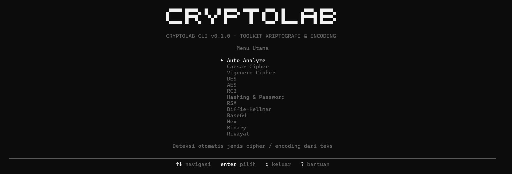

# CryptoLab CLI

<p align="center">
  <picture>
    <source media="(prefers-color-scheme: dark)" srcset="docs/assets/logo-dark.svg">
    <source media="(prefers-color-scheme: light)" srcset="docs/assets/logo-light.svg">
    
  </picture>
</p>

<p align="center"><b>Toolkit kriptografi &amp; encoding interaktif untuk praktikum dan CTF</b></p>

<p align="center">
  
  
  
  <a href="https://github.com/Ackerman237/CryptoLab-CLI/actions/workflows/pytest.yml"></a>
</p>

<p align="center">
  <a href="#instalasi-dari-nol">Instalasi dari Nol</a> ·
  <a href="#quick-start">Quick Start</a> ·
  <a href="#fitur">Fitur</a> ·
  <a href="docs/USAGE.md">Panduan Lengkap</a> ·
  <a href="#disclaimer">Disclaimer</a>
</p>

<p align="center">
  
</p>

## Fitur

| Kategori | Isi |
|---|---|
| Auto Analyze | Deteksi encoding bertingkat (maks. 5 tahap), Caesar brute-force, kandidat cipher ber-kunci |
| Classical | Caesar, Vigenere, Playfair, Hill, Affine, Rail Fence |
| Symmetric | DES, RC2 (legacy), AES (CBC/ECB/GCM) |
| Hashing & MAC | MD5, SHA1, SHA256, SHA512, HMAC, PBKDF2, Bcrypt (opsional) |
| Asymmetric | RSA (OAEP, PKCS#1 v1.5, PSS), Diffie-Hellman |
| Encoding | Base64, Hex, Binary |
| Riwayat | Log lokal tanpa menyimpan kunci rahasia |

## Instalasi dari Nol

Panduan ini untuk Anda yang **belum pernah** menyiapkan proyek Python di komputer. Ikuti
berurutan — jangan lompat, karena tiap langkah bergantung pada langkah sebelumnya.

### Ringkasan alur

```
cek Python → clone repo → masuk folder → buat venv → aktifkan venv
    → install paket → verifikasi → jalankan
```

### Langkah 1 — Pastikan Python sudah terpasang

CryptoLab butuh **Python 3.9 atau lebih baru**.

**Windows** (buka PowerShell):

```powershell
python --version
```

**Linux/macOS** (buka Terminal):

```bash
python3 --version
```

Anda harus melihat sesuatu seperti `Python 3.12.3`. Yang penting angka pertamanya
**3**, dan angka keduanya **minimal 9**.

- **Belum ada Python?** Unduh dari [python.org/downloads](https://www.python.org/downloads/).
  Saat memasang di Windows, **centang "Add Python to PATH"** di layar pertama installer —
  kalau tidak dicentang, perintah `python` tidak akan dikenali dan Anda harus memasang ulang.
- **Di Linux**, biasanya sudah ada. Kalau belum:
  `sudo apt install python3 python3-venv python3-pip` (Debian/Ubuntu).

> **Catatan Windows:** kalau `python` justru membuka Microsoft Store, artinya Python
> belum benar-benar terpasang. Pasang dari python.org lalu tutup-buka kembali PowerShell.

### Langkah 2 — Clone repositori

```bash
git clone https://github.com/Ackerman237/CryptoLab-CLI.git
cd CryptoLab-CLI
```

Belum punya `git`? Pasang dari [git-scm.com](https://git-scm.com/downloads).
Alternatif tanpa git: klik **Code → Download ZIP** di halaman GitHub, lalu ekstrak
dan masuk ke foldernya.

### Langkah 3 — Buat virtual environment

Virtual environment (venv) adalah "kotak" terpisah untuk paket proyek ini, supaya
tidak bercampur dengan paket Python lain di komputer Anda. Selalu lakukan ini —
jangan install langsung ke Python global.

```bash
python -m venv .venv
```

Di Linux/macOS, gunakan `python3 -m venv .venv`.

Perintah ini membuat folder `.venv/`. Folder itu **wajar ada** di komputer Anda,
dan memang **tidak ikut ke-commit** ke git (sudah diabaikan di `.gitignore`).

### Langkah 4 — Aktifkan virtual environment

**Windows PowerShell:**

```powershell
.\.venv\Scripts\Activate.ps1
```

**Linux/macOS:**

```bash
source .venv/bin/activate
```

Setelah aktif, prompt terminal Anda akan berawalan `(.venv)`. Itu tanda berhasil.

> **Jika muncul error "running scripts is disabled" di Windows**, jalankan perintah
> berikut sekali saja, lalu ulangi aktivasi di atas:
>
> ```powershell
> Set-ExecutionPolicy -Scope CurrentUser -ExecutionPolicy RemoteSigned
> ```

### Langkah 5 — Install CryptoLab

```bash
pip install -e .
```

Tanda titik di akhir penting: artinya "install proyek di folder ini". Ini sekaligus
memasang dua dependensi yang dibutuhkan secara otomatis:

| Paket | Kegunaan |
|---|---|
| `pycryptodome` | Algoritma kriptografi (AES, DES, RSA, dll.) |
| `readchar` | Membaca tombol panah di menu interaktif |

**Untuk ikut menjalankan tes**, install sekalian paket pengembangannya:

```bash
pip install -e ".[dev]"
```

### Langkah 6 — Verifikasi instalasi

Pastikan semuanya terpasang dengan benar:

```bash
cryptolab --version
```

Harus muncul `cryptolab 1.2.0`. Kalau muncul, instalasi sukses.

Coba juga uji cepat tanpa membuka menu:

```bash
cryptolab hash compute -t "halo" --algo SHA256
```

### Langkah 7 — Jalankan aplikasi

```bash
cryptolab
```

Menu interaktif akan terbuka. Gunakan panah `↑` `↓` untuk berpindah, `Enter` untuk
memilih, dan `q` untuk keluar.

### Jika perintah `cryptolab` tidak dikenali

Ini biasanya masalah PATH di Windows (folder Scripts tidak terdaftar). Solusi cepat —
jalankan lewat modul Python, yang selalu berhasil selama venv aktif:

```bash
python -m cryptolab
```

Untuk memperbaikinya permanen, tambahkan folder Scripts ke PATH. Jalankan di
PowerShell (**sesuaikan `Python312` dengan versi Python Anda**):

```powershell
$userPath=[Environment]::GetEnvironmentVariable("Path","User");$newPath="$env:APPDATA\Python\Python312\Scripts";if (($userPath -split ';') -notcontains $newPath) {[Environment]::SetEnvironmentVariable("Path","$userPath;$newPath","User")}
```

Tutup dan buka kembali PowerShell setelah menjalankannya.

### Menjalankan ulang di sesi berikutnya

Anda tidak perlu mengulang dari Langkah 1. Cukup:

```bash
cd CryptoLab-CLI
```

lalu aktifkan venv (Langkah 4), dan jalankan `cryptolab`.

### Mengatasi masalah umum

| Gejala | Penyebab & solusi |
|---|---|
| `python: command not found` | Python belum terpasang atau belum masuk PATH. Ulangi Langkah 1. |
| `running scripts is disabled` (Windows) | Jalankan `Set-ExecutionPolicy -Scope CurrentUser -ExecutionPolicy RemoteSigned`, lalu aktifkan venv lagi. |
| `cryptolab: command not found` | Venv belum aktif, atau PATH belum diset. Lihat bagian di atas. |
| `ModuleNotFoundError: Crypto` | `pip install -e .` belum dijalankan. Pastikan venv aktif dulu. |
| Logo tampak berantakan di terminal Windows | Terminal tidak mendukung glyph blok. Jalankan `cryptolab --ascii-logo`. |

## Quick Start

### Windows PowerShell

```bash
git clone https://github.com/Ackerman237/CryptoLab-CLI.git
cd CryptoLab-CLI
python -m venv .venv
.\.venv\Scripts\Activate.ps1
pip install -e .
cryptolab
```

Jika perintah `cryptolab` belum dikenali setelah instalasi user-level, tambahkan folder
Scripts ke PATH dengan satu baris PowerShell berikut:

```powershell
$userPath=[Environment]::GetEnvironmentVariable("Path","User");$newPath="$env:APPDATA\Python\Python312\Scripts";if (($userPath -split ';') -notcontains $newPath) {[Environment]::SetEnvironmentVariable("Path","$userPath;$newPath","User")}
```

Tutup dan buka kembali PowerShell setelah mengubah PATH. Untuk Python versi lain,
sesuaikan `Python312` dengan folder versi Python yang digunakan.

### Linux/macOS

```bash
git clone https://github.com/Ackerman237/CryptoLab-CLI.git
cd CryptoLab-CLI
python3 -m venv .venv
source .venv/bin/activate
pip install -e .
cryptolab
```

## Kontrol

| Tombol | Fungsi |
|---|---|
| ↑ ↓ | Pindah pilihan |
| Enter | Pilih |
| Esc / b | Kembali |
| ? | Bantuan |
| q | Keluar |

## Perintah cepat

```bash
cryptolab caesar brute-force -t "KHOOR" --best
cryptolab hash compute -t "data" --algo SHA256
cryptolab rsa keygen --bits 2048 --out-dir ./keys
```

Daftar lengkap ada di [docs/USAGE.md](docs/USAGE.md).

## Pengujian

```bash
pytest -v
```

## Disclaimer

Dibuat untuk pembelajaran dan CTF. DES, RC2, dan MD5/SHA-1 sudah usang dan tidak aman untuk sistem produksi.

## Lisensi

MIT © Praktikan Keamanan Informasi