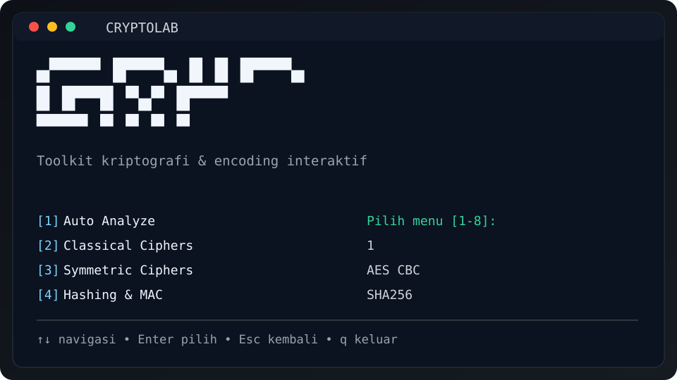

# CryptoLab CLI

<p align="center">
  <picture>
    <source media="(prefers-color-scheme: dark)" srcset="docs/assets/logo-dark.svg">
    <source media="(prefers-color-scheme: light)" srcset="docs/assets/logo-light.svg">
    
  </picture>
</p>

<p align="center"><b>Toolkit kriptografi &amp; encoding interaktif untuk praktikum dan CTF</b></p>

<p align="center">
  
  
  
  <a href="https://github.com/Ackerman237/CryptoLab-CLI/actions/workflows/pytest.yml"></a>
</p>

<p align="center">
  <a href="#quick-start">Quick Start</a> ·
  <a href="#fitur">Fitur</a> ·
  <a href="docs/USAGE.md">Panduan Lengkap</a> ·
  <a href="#disclaimer">Disclaimer</a>
</p>

<p align="center">
  
</p>

## Fitur

| Kategori | Isi |
|---|---|
| Auto Analyze | Deteksi encoding bertingkat (maks. 5 tahap), Caesar brute-force, kandidat cipher ber-kunci |
| Classical | Caesar, Vigenere, Playfair, Hill, Affine, Rail Fence |
| Symmetric | DES, RC2 (legacy), AES (CBC/ECB/GCM) |
| Hashing & MAC | MD5, SHA1, SHA256, SHA512, HMAC, PBKDF2, Bcrypt (opsional) |
| Asymmetric | RSA (OAEP, PKCS#1 v1.5, PSS), Diffie-Hellman |
| Encoding | Base64, Hex, Binary |
| Riwayat | Log lokal tanpa menyimpan kunci rahasia |

## Quick Start

```bash
git clone https://github.com/Ackerman237/CryptoLab-CLI.git
cd CryptoLab-CLI
python -m venv .venv
# Windows PowerShell
.\.venv\Scripts\Activate.ps1
# Linux/macOS
# source .venv/bin/activate
pip install -e .
cryptolab
```

## Kontrol

| Tombol | Fungsi |
|---|---|
| ↑ ↓ | Pindah pilihan |
| Enter | Pilih |
| Esc / b | Kembali |
| ? | Bantuan |
| q | Keluar |

## Perintah cepat

```bash
cryptolab caesar brute-force -t "KHOOR" --best
cryptolab hash compute -t "data" --algo SHA256
cryptolab rsa keygen --bits 2048 --out-dir ./keys
```

Daftar lengkap ada di [docs/USAGE.md](docs/USAGE.md).

## Pengujian

```bash
pytest -v
```

## Disclaimer

Dibuat untuk pembelajaran dan CTF. DES, RC2, dan MD5/SHA-1 sudah usang dan tidak aman untuk sistem produksi.

## Lisensi

MIT © Praktikan Keamanan Informasi