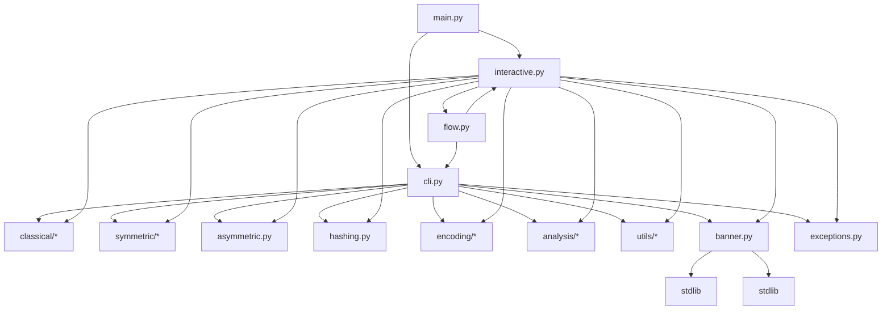

# CryptoLab CLI - Refactor Plan

**Berdasarkan:** `docs/audit/AUDIT_REPORT.md`  
**Tanggal:** 2026-10-19  
**Versi:** 1.0.0

---

## 1. Kondisi Sekarang & Masalah Utama

### Diagram Mermaid: Dependensi Saat Ini


### Masalah Struktural Utama (Top 3)

| # | Masalah | Dampak | File Terdampak |
|---|---------|--------|----------------|
| 1 | **God File `interactive.py` (3,281 lines)** | Sulit test, maintain, extend; SRP violation parah | `interactive.py` |
| 2 | **God File `cli.py` (1,677 lines)** | CLI parsing + UI rendering + business logic tercampur | `cli.py` |
| 3 | **UI System Terfragmentasi** | 3 render system berbeda, duplikasi 50+ divider, 2 color system, 2 center_block | `cli.py`, `interactive.py`, `banner.py` |

---

## 2. Arsitektur Target

### Diagram Mermaid: Target Architecture

```mermaid
graph TD
    %% Entry Points
    main[main.py] --> cli_pkg[cli/]
    main --> interactive_pkg[interactive/]
    
    %% CLI Package
    cli_pkg --> cli_main[__main__.py]
    cli_pkg --> cli_commands[commands/]
    cli_pkg --> cli_formatters[formatters/]
    cli_pkg --> cli_parser[parser.py]
    
    %% Interactive Package
    interactive_pkg --> interactive_main[__main__.py]
    interactive_pkg --> interactive_menu[menu.py]
    interactive_pkg --> interactive_handlers[handlers/]
    interactive_pkg --> interactive_widgets[widgets/]
    
    %% Shared UI System
    ui[ui/] --> ui_theme[theme.py]
    ui --> ui_widgets[widgets/]
    ui --> ui_layout[layout.py]
    
    %% Core Crypto (Unchanged)
    core[core/] --> classical[classical/]
    core --> symmetric[symmetric/]
    core --> asymmetric[asymmetric/]
    core --> hashing[hashing/]
    core --> encoding[encoding/]
    core --> analysis[analysis/]
    
    %% Shared
    shared[shared/] --> utils[utils/]
    shared --> exceptions[exceptions.py]
    shared --> config[config.py]
    
    %% Dependencies (ONE DIRECTION)
    cli_pkg --> ui
    cli_pkg --> core
    cli_pkg --> shared
    
    interactive_pkg --> ui
    interactive_pkg --> core
    interactive_pkg --> shared
    
    flow[flow.py] --> core
    flow --> shared
    
    style ui fill:#e1f5fe
    style core fill:#f3e5f5
    style shared fill:#fff3e0
```


### Target Folder Structure
```
src/cryptolab/
├── main.py                 # Entry point (unchanged)
├── __init__.py             # Public API exports
├── config.py               # App config (theme, defaults)
├── exceptions.py           # Custom exceptions
│
├── ui/                     # === DESIGN SYSTEM (NEW) ===
│   ├── __init__.py
│   ├── theme.py            # Colors, symbols, tokens
│   ├── layout.py           # Header, Footer, Page, Panel
│   └── widgets/
│       ├── __init__.py
│       ├── rule.py         # Rule/Divider widget
│       ├── message.py      # Message (error/success/warning/info)
│       ├── prompt.py       # Input, Choose, Confirm
│       ├── menu.py         # Navigation menu
│       ├── keyvalue.py     # Key-value display
│       ├── table.py        # Table widget
│       ├── panel.py        # Result panel/card
│       └── task.py         # Spinner/Progress/Steps
│
├── cli/                    # === CLI COMMANDS ===
│   ├── __init__.py
│   ├── __main__.py         # CLI entry
│   ├── parser.py           # Argparse setup
│   ├── commands/           # One file per command
│   │   ├── __init__.py
│   │   ├── caesar.py
│   │   ├── vigenere.py
│   │   ├── des.py
│   │   ├── aes.py
│   │   ├── hash.py
│   │   └── ...
│   └── formatters/         # Output formatters (using ui.widgets)
│       ├── __init__.py
│       ├── result.py       # render_box -> Panel
│       ├── error.py
│       └── history.py
│
├── interactive/            # === INTERACTIVE MENU ===
│   ├── __init__.py
│   ├── __main__.py         # Interactive entry
│   ├── menu.py             # Main menu definition
│   ├── navigation.py       # Keyboard navigation
│   ├── handlers/           # One file per feature
│   │   ├── __init__.py
│   │   ├── classical.py
│   │   ├── symmetric.py
│   │   ├── asymmetric.py
│   │   ├── hashing.py
│   │   ├── encoding.py
│   │   ├── analysis.py
│   │   └── history.py
│   └── widgets/            # Interactive-specific widgets (thin wrappers)
│
├── flow.py                 # Three-phase flow (refactored)
│
├── core/                   # === CRYPTO CORE (EXTRACTED) ===
│   ├── __init__.py
│   ├── classical/
│   ├── symmetric/
│   ├── asymmetric/
│   ├── hashing/
│   ├── encoding/
│   └── analysis/
│
├── utils/                  # History, helpers
└── banner.py               # Logo only (moved to ui/theme.py eventually)
```

### Prinsip Dependensi
1. **UI (`ui/`)** - Zero dependency ke kode fitur, hanya stdlib
2. **Core (`core/`)** - Zero dependency ke UI/CLI, pure crypto logic
3. **CLI (`cli/`)** - Depends on `ui/` + `core/` + `shared/`
4. **Interactive (`interactive/`)** - Depends on `ui/` + `core/` + `shared/`
5. **Flow (`flow.py`)** - Depends on `core/` + `shared/` (no UI)
6. **Shared (`config.py`, `exceptions.py`, `utils/`)** - Leaf nodes

---

## 3. Roadmap Bertahap

### Konvensi
- **S** = Small (<1 hari), **M** = Medium (1-3 hari), **L** = Large (3-7 hari)
- Setiap langkah = 1 PR/merge kecil, test sebelum & sesudah
- Urutan wajib: **Security → Test → Extract → Clean → Polish**

---

### PHASE A: Keamanan Critical/High (Security First)

| Step | Tujuan | File Terdampak | Verifikasi | Risiko | Rollback | Effort |
|------|--------|----------------|------------|--------|----------|--------|
| A1 | Tambah warning MD5/SHA-1/ECB/RC2 di UI | `ui/widgets/message.py` (new), handlers | Manual test semua cipher | Rendah | Revert file | S |
| A2 | Fix `hmac_verify` & `hash_verify_integrity` pakai `hmac.compare_digest` | `core/hashing.py` | Test unit baru + existing | Rendah | Revert | S |
| A3 | Enforce minimum PBKDF2 iter (100k) & Bcrypt cost range (4-31) | `core/hashing.py` | Test edge cases | Rendah | Revert | S |
| A4 | Hapus/guard key/IV dari history log | `utils/history.py` | Test history dengan secret | Sedang | Revert | S |
| A5 | Deprecation warning RSA PKCS#1 v1.5 | `core/asymmetric.py` | Test CLI & interactive | Rendah | Revert | S |

---

### PHASE B: Characterization Tests (Sebelum Pindah Kode)

| Step | Tujuan | File Terdampak | Verifikasi | Risiko | Rollback | Effort |
|------|--------|----------------|------------|--------|----------|--------|
| B1 | Test snapshot semua CLI command output | `tests/test_cli_snapshot.py` (new) | `pytest tests/test_cli_snapshot.py` | Rendah | Delete test file | M |
| B2 | Test snapshot interactive menu rendering | `tests/test_interactive_snapshot.py` (new) | Mock stdin/stdout, compare output | Sedang | Delete test file | M |
| B3 | Test semua crypto primitive (round-trip) | `tests/test_crypto_roundtrip.py` (new) | Encrypt→decrypt = identity | Rendah | Delete test file | M |
| B4 | Test history log format & secrets filtering | `tests/test_history_security.py` (new) | Check no keys in output | Rendah | Delete test file | S |

---

### PHASE C: Ekstraksi UI Design System (Jalur B - Widget UI)

| Step | Tujuan | File Terdampak | Verifikasi | Risiko | Rollback | Effort |
|------|--------|----------------|------------|--------|----------|--------|
| B1 | Ekstrak `ui/theme.py` (colors, symbols, tokens) | `ui/theme.py` (new), `banner.py` | Snapshot test theme | Rendah | Delete ui/ | S |
| B2 | Widget `Rule` (ganti semua `=`/`─`/`-` divider) | `ui/widgets/rule.py`, replace di cli/interactive | Snapshot width 40/60/80/120 | Rendah | Revert | S |
| B3 | Widget `Message` (error/success/warning/info) | `ui/widgets/message.py`, replace di cli/interactive | Snapshot test | Rendah | Revert | S |
| B4 | Widget `Prompt` (ask/choose/confirm) | `ui/widgets/prompt.py`, replace `safe_input` | Manual test input flow | Sedang | Revert | M |
| B5 | Widget `KeyValue` & `Table` | `ui/widgets/keyvalue.py`, `table.py` | Snapshot test | Rendah | Revert | M |
| B6 | Widget `Panel` (ganti `render_box`, `render_card`) | `ui/widgets/panel.py`, replace both | Snapshot test | Rendah | Revert | M |
| B7 | Widget `Menu` & `Navigation` | `ui/widgets/menu.py`, `navigation.py` | Snapshot test | Sedang | Revert | M |
| B8 | Widget `Header`/`Footer`/`Page` | `ui/layout.py`, replace `render_header`, `render_footer` | Snapshot test | Rendah | Revert | S |
| B9 | Widget `Task` (spinner/progress/steps) | `ui/widgets/task.py` | Manual test | Rendah | Revert | S |
| B10 | Test penjaga: grep larangan `print/input` di fitur, ANSI mentah, divider manual | `tests/test_ui_guard.py` (new) | CI fail kalau pola lama ditemukan | Rendah | Delete test | S |

---

### PHASE D: Ekstraksi Modul dari File Terbesar (Jalur A - Modularisasi)

| Step | Tujuan | File Terdampak | Verifikasi | Risiko | Rollback | Effort |
|------|--------|----------------|------------|--------|----------|--------|
| C1 | Pecah `cli.py` → `cli/commands/` + `cli/formatters/` | `cli.py` → `cli/` package | All CLI tests pass | Sedang | Git revert | L |
| C2 | Pecah `interactive.py` → `interactive/handlers/` + `interactive/menu.py` | `interactive.py` → `interactive/` package | All interactive tests pass | Sedang | Git revert | L |
| C3 | Ekstrak `core/` package dari module sdh ada | Move `classical/`, `symmetric/`, etc to `core/` | Import paths updated, tests pass | Sedang | Git revert | M |
| C4 | Hapus dead code (`LOGO_*`, `_PIXEL_FONT`, `fix_*.py`) | `interactive.py`, root cleanup | No import errors | Rendah | Git revert | S |

---

### PHASE E: Pembersihan & Polish

| Step | Tujuan | File Terdampak | Verifikasi | Risiko | Rollback | Effort |
|------|--------|----------------|------------|--------|----------|--------|
| D1 | Hapus duplikasi `DIVIDER`, `center_block`, `color_*`, `render_footer` | `cli.py`, `interactive.py`, `banner.py` | All tests pass | Rendah | Revert | S |
| D2 | Tambah `lint`, `typecheck`, `format` di `pyproject.toml` | `pyproject.toml` | `ruff check`, `mypy`, `black --check` pass | Rendah | Revert | S |
| D3 | Setup CI (GitHub Actions) | `.github/workflows/ci.yml` | CI green on push | Rendah | Delete workflow | S |
| D4 | Update docs & README | `README.md`, `docs/` | Manual review | Rendah | Revert | S |

---

## 4. Quick Wins (<1 Jam, Bisa Dikerjakan Sekarang)

| # | Quick Win | File | Estimasi |
|---|-----------|------|----------|
| Q1 | Hapus 30+ file `fix_*.py` di root | Root dir | 5 menit |
| Q2 | Hapus dead code `LOGO_LARGE`, `_PIXEL_FONT`, `_build_pixel_logo` di `interactive.py` | `interactive.py` | 10 menit |
| Q3 | Consolidate `DIVIDER`/`THIN_DIVIDER` ke `ui/theme.py` | `cli.py:66-67`, `interactive.py:65-66` | 15 menit |
| Q4 | Tambah warning MD5/SHA-1 di `hashing.py` | `hashing.py` | 15 menit |
| Q5 | Fix `hmac.compare_digest` di `hmac_verify` | `hashing.py:280` | 10 menit |
| Q6 | Tambah `ruff`, `mypy`, `black` ke `pyproject.toml` dev deps | `pyproject.toml` | 10 menit |

---

## 5. Definisi Selesai & Metrik Keberhasilan

### Definition of Done per Step
- [ ] Semua test existing lulus (`pytest tests/ -v`)
- [ ] Test karakterisasi baru lulus (snapshot match)
- [ ] `ruff check src/` clean (no warnings)
- [ ] `mypy src/` clean (no errors)
- [ ] Manual smoke test: `cryptolab menu`, `cryptolab caesar --help`, dll
- [ ] Tidak ada regex `print\(|input\(` di folder fitur (`core/`, `cli/commands/`, `interactive/handlers/`)
- [ ] Tidak ada ANSI mentah (`\033[`) di kode fitur
- [ ] Tidak ada divider manual (`"=" * n`, `"-" * n`, `"." * n`)

### Metrik Target Akhir
| Metrik | Saat Ini | Target |
|--------|----------|--------|
| Max file lines | 3,281 (`interactive.py`) | **< 500** |
| Max function lines | ~200 (handler functions) | **< 50** |
| Circular imports | 3+ (cli↔interactive↔flow) | **0** |
| UI render systems | 3 (cli, interactive, banner) | **1** (`ui/`) |
| Crypto algos tanpa warning | 4 (MD5, SHA1, ECB, RC2) | **0** |
| Test coverage | ~60% (est.) | **> 85%** |
| Non-constant-time compare | 2 locations | **0** |

---

## 6. Urutan Eksekusi Wajib

```
A1→A5 (Security) → B1→B4 (Characterization Tests) 
    → B1→B10 (UI Widgets - Jalur B, parallel dengan C1-C4 jika aman)
    → C1→C4 (Modularisasi - Jalur A)
    → D1→D4 (Polish)
```

**Catatan:** Jalur B (UI Widgets) dan Jalur A (Modularisasi) bisa paralel **SETelah** characterization tests (B1-B4) selesai. Kalau file sama jadi target (misal `cli.py`), urutkan: extract UI widgets dulu (B2-B8), baru pecah file (C1).

---

## 7. Rencana Rollback Global

Jika ada regresi mayor di tengah jalan:
1. `git stash` atau `git checkout main` ke commit sebelum refactor
2. Atau revert commit-by-commit (setiap step = 1 commit)
3. Branch `refactor/phase-X` per phase untuk isolasi

---

*Next: Create `docs/audit/PROGRESS.md` checklist, then `.agent/` folder setup (Fase 6)*